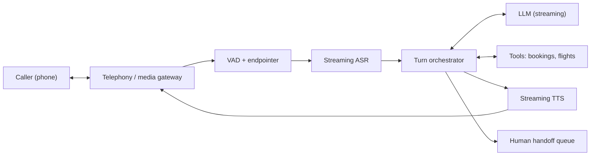

There are two broad shapes for a voice agent. The **cascaded pipeline** chains three models: speech recognition (**ASR**) turns audio into text, an LLM decides what to say, and text-to-speech (**TTS**) turns the reply into audio. A **speech-to-speech** model takes audio in and produces audio out directly. The cascade is easier to debug, lets you swap each piece and gives you a text transcript for tools, logging and guardrails. Speech-to-speech can be faster and keeps tone of voice, but it is harder to constrain and audit. In an interview, design the cascade first and name speech-to-speech as the alternative you would evaluate.

The key architectural idea is that **nothing waits for anything to finish**. Audio streams into the ASR in 20 ms frames. Partial transcripts stream out. The LLM's tokens stream into the TTS phrase by phrase, and audio streams back to the caller while the LLM is still writing. A design that hands complete messages from stage to stage adds the full duration of each stage and will never get under a second.



| Component | Job | Latency it owns |
|---|---|---|
| Media gateway | Terminates the call, converts codecs, runs echo cancellation | Network and jitter buffer |
| VAD + endpointer | Decides when the caller is speaking and when they have finished | Silence wait at end of turn |
| Streaming ASR | Emits partial and final transcripts | Finalisation after the endpoint |
| Turn orchestrator | Holds call state, builds the prompt, runs tools, enforces policy, handles barge-in | Its own processing, plus tool calls |
| LLM | Produces the reply as a token stream | TTFT and the first phrase |
| Streaming TTS | Converts text chunks to audio | Time to first audio byte |

The orchestrator is the brain of the system and the part you write yourself. It is a per-call state machine with states like *listening*, *thinking*, *speaking* and *transferring*, and it is where the latency budget is enforced.

## One turn, end to end

The caller says "My flight to Denver got cancelled, can you put me on the next one?" Here is everything that happens before they hear a reply, with the budget each step is allowed.

```steps
One turn of the airline agent
**Audio in (0 ms onward).** The media gateway forwards 20 ms frames. The VAD marks speech; ASR emits partials such as "my flight to denver got" while the caller is still talking. Nothing about the reply can start yet.
---
**End of turn (+200 ms).** The caller stops. The endpointer waits for 200 ms of silence and also checks the partial transcript looks complete (it ends in a question). It declares end of turn. The ASR finalises the transcript in about 40 ms.
---
**Prompt assembly (+5 ms).** The orchestrator appends the caller's words to the conversation. The system prompt, tool definitions and earlier turns are already in the prefix cache, so only about 20 new tokens need prefill.
---
**LLM first token (+250 ms).** The model decides to call `find_next_flight(booking_id)`. Instead of silence, the orchestrator immediately plays a cached filler ("Let me check that for you") from pre-rendered audio while the tool runs.
---
**Tool and second LLM call (+300 to 600 ms, masked by the filler).** The tool returns two options. The LLM streams "The next flight to Denver leaves at 6:40 pm..." The orchestrator cuts the stream at the first clause boundary, about 6 tokens, and sends it to TTS.
---
**Audio out (+110 ms TTS, +50 ms network).** The first audio frame reaches the caller. TTS keeps synthesizing the rest of the sentence ahead of playback. The orchestrator records exactly which words have been played, in case the caller interrupts.
```

Two tricks in that walkthrough carry most of the weight. The **prefix cache** means each turn prefills a handful of new tokens instead of the whole 2,000-token conversation. The **filler** hides tool latency, but it must be honest and short: a filler that plays every turn sounds robotic, so it fires only when a tool call is predicted.

## How much does prefix caching save?

Prefill time grows roughly linearly with the number of uncached tokens. If the model prefills at a rate $r$ tokens per second, the prefill part of TTFT is

$$
t_{prefill} \approx \frac{n_{new}}{r}
$$

where $n_{new}$ is the number of tokens not already in the cache. Take a replica that prefills at $r = 10{,}000$ tokens per second for a single request. Without caching, a turn late in the call sends all $2{,}000$ tokens: $2{,}000 / 10{,}000 = 0.2$ s, which is 200 ms of the 800 ms budget gone. With the conversation prefix cached, $n_{new} \approx 20$ and prefill takes $20/10{,}000 = 2$ ms. The remaining TTFT is queueing plus the first decode step.

The catch is that a cache only helps if the next turn lands on the same replica while the entry is still there. That is why the orchestrator routes every turn of a call to the same LLM replica (**session affinity**), and why the KV memory estimate from the previous topic matters: evict a caller's prefix during a long pause and their next turn pays the full prefill.

```quiz
{"q": "A replica prefills 8,000 tokens/s. A turn has 2,400 context tokens, of which 2,360 are in the prefix cache. Roughly how long is prefill?", "options": ["300 ms", "5 ms", "30 ms", "0.3 ms"], "answer": 1, "explain": "Only the 40 uncached tokens need prefill: $40 / 8{,}000 = 0.005$ s = 5 ms. 300 ms is what you pay with no cache ($2{,}400/8{,}000$)."}
```

```quiz
{"q": "Why does the orchestrator pin all turns of a call to one LLM replica?", "options": ["So the KV-cache entry for the conversation prefix is reused", "Because LLMs cannot read transcripts from other replicas", "To make billing per call easier", "To keep TTS voices consistent"], "answer": 0, "explain": "Prefix caches live in a replica's GPU memory. Route turn 7 to a different replica and it must prefill the whole conversation again. Transcripts are plain text and any replica could read them; the point is the cached computation."}
```

## In practice

Production orchestrators log a timestamp at every boundary in the walkthrough (speech end, endpoint fired, transcript final, first token, first TTS byte, first audio played). Without those six numbers per turn you cannot tell whether a slow p95 comes from the endpointer, a tool, the LLM queue or the TTS vendor, and every latency debate turns into guesswork.
