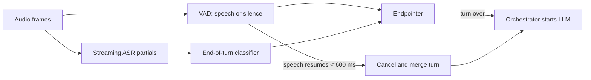

People pause in the middle of sentences. "My booking number is... hang on... K, L, seven." A voice agent has to tell a thinking pause from the end of a turn, and it has to decide quickly, because every millisecond it waits is added straight to the reply latency. This decision is called **endpointing**, and it is the single most underrated component in voice design.

Two signals feed it. A **voice activity detector (VAD)** classifies each 20 ms audio frame as speech or not speech; it is cheap and fast but knows nothing about meaning. The **streaming ASR** emits **partial transcripts** as the caller speaks and a **final transcript** once it is told the utterance is over. Partials let downstream work start early (looking up a booking number as soon as it is heard), and they let the endpointer ask whether the words so far sound like a finished thought.

## Silence-only endpointing and its failure rate

The simplest rule: declare end of turn after $\theta$ milliseconds of continuous silence. Short $\theta$ is fast but cuts people off mid-sentence; long $\theta$ is safe but slow. We can put numbers on that trade.

Model the length of a mid-utterance pause as exponential with mean $\mu$. The probability that one pause is longer than the threshold, and so triggers a false end of turn, is

$$
p(\theta) = e^{-\theta/\mu}
$$

If an utterance contains $m$ such pauses, the probability that at least one of them cuts the caller off is

$$
P_{cut}(\theta) = 1 - \left(1 - p(\theta)\right)^m
$$

Take $\mu = 120$ ms and $m = 3$ pauses per utterance (both illustrative; measure your own callers).

| Silence threshold $\theta$ | Per-pause false trigger $p$ | Utterances cut off $P_{cut}$ | Latency added to every real turn end |
|---|---|---|---|
| 200 ms | 18.9% | 46.6% | 200 ms |
| 300 ms | 8.2% | 22.7% | 300 ms |
| 500 ms | 1.6% | 4.6% | 500 ms |
| 800 ms | 0.13% | 0.38% | 800 ms |

Check one row: $p(500) = e^{-500/120} = e^{-4.17} = 0.0155$, and $1 - (1 - 0.0155)^3 = 0.0458$. Silence alone cannot give both a 200 ms wait and a low cut-off rate. A 200 ms rule interrupts almost half the callers; an 800 ms rule spends the whole latency budget waiting.

## Semantic endpointing

The fix is to use meaning as well as silence. A small **end-of-turn classifier** reads the latest partial transcript (and, in better systems, prosody such as falling pitch) and predicts whether the caller has finished. The endpointer then uses a short threshold when the words look complete and a long one when they do not:

$$
\theta = \begin{cases} 200 \text{ ms} & \text{if the classifier says complete} \\ 800 \text{ ms} & \text{otherwise} \end{cases}
$$

```steps
Semantic endpointing, by the numbers
**Real turn ends.** Suppose 70% of real turn ends look complete to the classifier ("...the next flight to Denver?"). Average wait $= 0.7 \times 200 + 0.3 \times 800 = 380$ ms, and the median turn waits only 200 ms, which is what the latency budget assumed.
---
**Mid-utterance pauses.** The classifier wrongly says "complete" at 5% of thinking pauses ("my booking number is..."). A pause then cuts off with probability $0.05 \times e^{-200/120} + 0.95 \times e^{-800/120} = 0.05 \times 0.189 + 0.95 \times 0.0013 = 0.0107$.
---
**Per utterance.** With 3 pauses: $1 - (1 - 0.0107)^3 = 3.2\%$ of utterances cut off.
---
**Compare.** Silence-only at 200 ms: 46.6% cut off. Silence-only at 500 ms: 4.6% cut off but 500 ms on every turn. Semantic endpointing beats both: a 200 ms median wait with fewer cut-offs than the 500 ms rule.
```

## Recovering from a cut-off

Even 3% of utterances is several thousand a day at this scale, so the design needs a recovery path. If the VAD detects the caller speaking again within a short window (say 600 ms) after an endpoint fired, the orchestrator cancels the in-flight LLM request, merges the new words into the same turn and starts again. Because nothing has been spoken yet, the caller never notices; the cost is one wasted LLM request. This is the same machinery as barge-in, covered next.



## Starting early on partials

Partials also allow **speculative work**. When the partial transcript stabilises (the last few partials agree), the orchestrator can start the LLM request before the endpointer fires. If the final transcript matches, you have saved most of the TTFT; if it differs, you discard the result. With an acceptance rate $a$ and a saving of $s$ ms, the expected saving per turn is $a \cdot s$. With $a = 0.6$ and $s = 250$ ms that is 150 ms per turn on average, paid for with roughly $1/a \approx 1.7$ times as many LLM prefills, at most. For a cheap prefix-cached prefill that trade is usually worth it.

```quiz
{"q": "With mid-utterance pauses exponential with mean 100 ms and 2 pauses per utterance, what fraction of utterances does a 300 ms silence rule cut off?", "options": ["About 5%", "About 10%", "About 0.25%", "About 30%"], "answer": 1, "explain": "$p = e^{-300/100} = e^{-3} = 0.0498$. Then $1 - (1-0.0498)^2 = 0.097$, about 10%. 5% is the per-pause probability, forgetting there are two chances per utterance."}
```

```quiz
{"q": "Why does semantic endpointing beat any single silence threshold?", "options": ["It removes the need for a VAD", "It uses a short wait when the words look finished and a long wait when they do not, so speed and cut-off rate are no longer tied to one number", "It makes the ASR more accurate", "It lets the LLM generate faster"], "answer": 1, "explain": "A fixed threshold forces one trade-off for every turn. Conditioning the threshold on whether the transcript looks complete gets the short wait on most real turn ends and the long wait on most thinking pauses. The VAD is still needed to measure silence."}
```

## In practice

Endpointing is tuned per use case. Reading out a 16-digit card number or spelling a name needs a long threshold and a "digits mode"; a quick yes/no confirmation can use a very short one. Good orchestrators switch endpointing profiles based on what the agent just asked.
