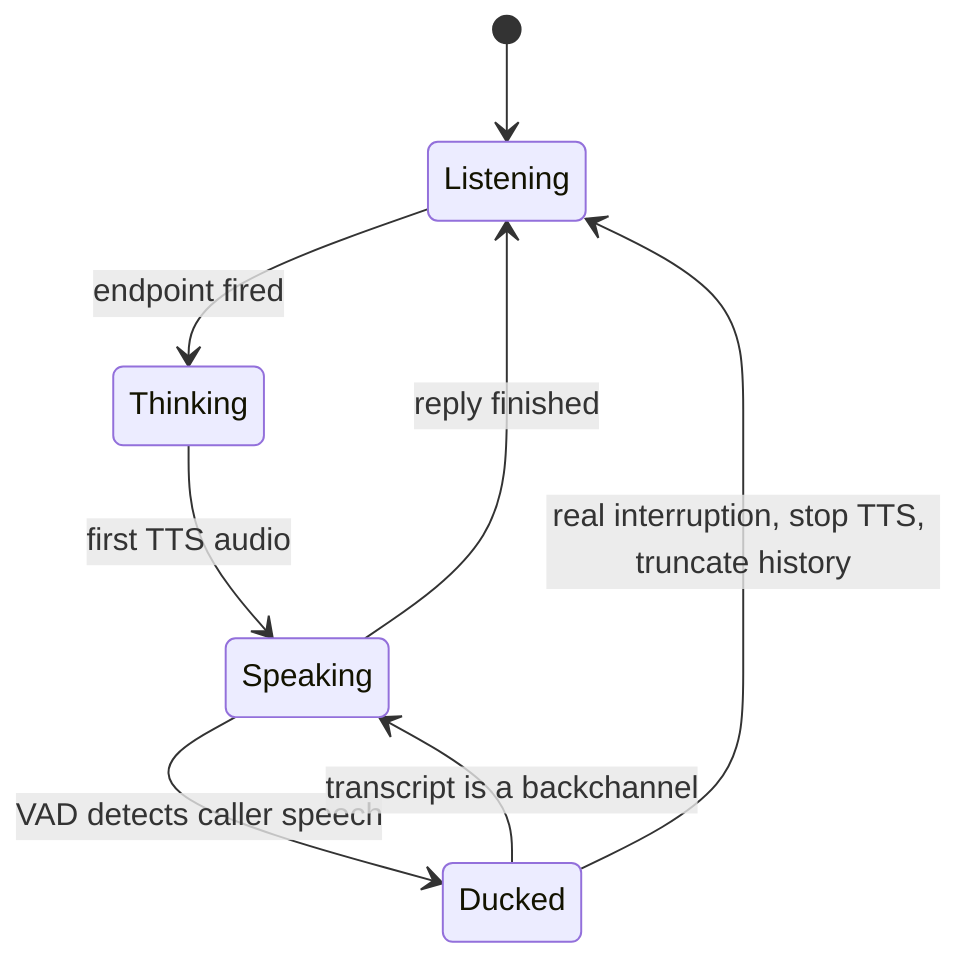

Callers interrupt. They already know their booking number, they heard the flight time they wanted, or the agent misunderstood and they want to correct it now. **Barge-in** is the ability to detect that the caller has started speaking while the agent is talking, stop the agent quickly, and carry on as if the interruption were a normal turn. Without it, the caller has to sit through every sentence; with a bad version of it, the agent stops every time someone coughs.

Barge-in has three parts: **detect** that the caller is really speaking to the agent, **stop** playback fast, and **reconcile** the conversation history with what the caller actually heard. The third part is where most designs go wrong.

## Detecting a real interruption

The danger is false triggers. Three sources are common:

- **Echo.** On a speakerphone the agent's own voice leaks back into the microphone. Without **acoustic echo cancellation** (AEC) in the media path, the agent interrupts itself.
- **Backchannels.** Short acknowledgements such as "uh-huh", "yeah" or "okay" mean "keep going", not "stop".
- **Noise.** Coughs, a door, a television.

A common rule requires a minimum duration of speech $d_{min}$ before treating it as barge-in. The time the caller and agent talk over each other is then

$$
t_{overlap} = d_{min} + t_{stop}
$$

where $t_{stop}$ is the time to cancel TTS and flush audio already queued in buffers. With $d_{min} = 200$ ms and $t_{stop} = 60$ ms, the overlap is 260 ms: noticeable but acceptable. Raise $d_{min}$ to 500 ms to ignore most backchannels and the overlap becomes 560 ms, which feels like the agent is not listening.

A better pattern is **soft barge-in**: the moment the VAD fires, duck the agent's volume; after the partial transcript arrives, decide. If the words are a backchannel, restore volume and continue; otherwise stop and start a new turn. The caller hears an instant reaction, and the agent still ignores "uh-huh".



## Reconciling what was heard

The LLM wrote a full reply, but the caller heard only part of it. If the conversation history stores the full reply, the model will later believe it said things the caller never heard ("as I mentioned, there is a \$75 change fee"). The orchestrator must truncate the assistant message to the words actually played.

If playback ran for $t_{played}$ seconds at a speaking rate of $r$ words per second, the number of words heard is

$$
w_{heard} \approx r \cdot t_{played}
$$

```steps
Truncating the reply after an interruption
The LLM's reply: "The next flight to Denver leaves at 6:40 pm and arrives at 9:15 pm, shall I book it?" That is 18 words. At a typical $r = 2.5$ words per second (150 words a minute) it takes about $18 / 2.5 = 7.2$ s to say.
---
The caller interrupts after $t_{played} = 3.4$ s. Estimated words heard: $2.5 \times 3.4 = 8.5$, so the first 8 words: "The next flight to Denver leaves at 6:40".
---
The estimate is rough, so production systems use **word timestamps** returned by the TTS engine and the playback clock from the media gateway instead of an average rate. The orchestrator replaces the assistant turn in history with exactly the played words, marked as interrupted.
---
The caller says "No, something earlier." The model now sees that it offered a 6:40 departure, was cut off, and the caller wants an earlier flight. It does not assume the caller heard the arrival time or agreed to book.
```

Truncation also matters for actions. If the agent was halfway through "I have cancelled your booking..." when the caller interrupted, did the cancellation happen? Tool calls must be decoupled from speech: the action either completed before the agent started describing it, or it waits for an explicit spoken confirmation. Never let a side effect depend on whether a sentence finished playing.

## Cancelling the right work

On a real interruption the orchestrator cancels three things: queued TTS audio, any TTS synthesis in progress, and the LLM generation if it is still streaming. Cancelling the LLM stream frees a batch slot; at 33 generations per second at peak, leaving abandoned streams running wastes capacity in direct proportion to the interruption rate. If 15% of turns are interrupted halfway through a 60-token reply, cancelling saves about $0.15 \times 30 = 4.5$ tokens per turn on average, about 7.5% of decode work.

```quiz
{"q": "An agent's reply is 24 words. The caller interrupts 4 seconds into playback; the agent speaks at 2.5 words per second. What should the conversation history contain for that assistant turn?", "options": ["All 24 words, because the model wrote them", "About the first 10 words, marked as interrupted", "Nothing, the turn should be deleted", "The first 4 words"], "answer": 1, "explain": "$2.5 \\times 4 = 10$ words were heard. Keeping all 24 makes the model believe the caller heard things they did not; deleting the turn loses what was actually said. 4 words confuses seconds with words."}
```

```quiz
{"q": "With soft barge-in, what happens when the caller says \"uh-huh\" while the agent is speaking?", "options": ["The agent stops and starts a new turn", "The agent's volume dips briefly, the transcript is recognised as a backchannel, and playback continues", "Nothing is detected because the VAD ignores short speech", "The call is transferred to a human"], "answer": 1, "explain": "Soft barge-in reacts immediately by ducking volume, then decides based on the words. A backchannel restores normal playback. A hard rule would either stop on every 'uh-huh' or, with a long minimum duration, react slowly to real interruptions."}
```

## In practice

Barge-in bugs are some of the most visible failures in voice products: the agent that keeps talking over an angry caller, or the one that apologises for being interrupted by its own echo. Test with recorded calls that include speakerphone echo, backchannels and real interruptions, and track the **false barge-in rate** and **missed barge-in rate** as separate metrics.
