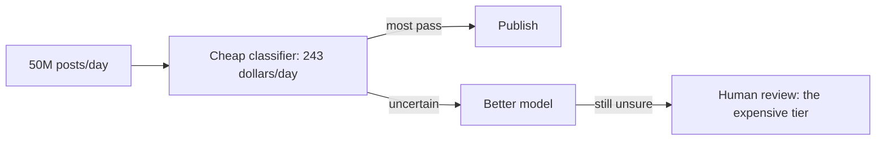

```callout-before
Before you start
This case walks the framework from [A Framework for LLM System Design](/learn/llm-system-design/design-framework). You need only multiplication and division. All prices are hypothetical.
```

"Design content moderation for a social platform with 50 million posts a day." Interviewers like this prompt because the model is the easy part. The difficulty is that **violations are rare**: if one post in two hundred breaks the rules, then 199 of every 200 things your system looks at are fine, and every small error rate on the good posts is multiplied by an enormous number. Moderation is a system for finding a needle in a haystack without setting fire to the haystack.

## Clarify first

| Question | Assumption we will use | Why it matters |
|---|---|---|
| Content types? | Short text posts (images and video are a later phase) | Text is cheap; images need a separate model |
| Volume? | 50M posts per day | Sets QPS and cost |
| Violation rate? | 0.5% of posts break a written policy | The base rate drives precision |
| When must the decision land? | Before the post is visible for severe classes; within minutes for the rest | Synchronous versus asynchronous design |
| What actions exist? | Allow, demote, send to review, remove, suspend account | A score is not an action; policy defines the bands |
| Human capacity? | A review team, about 30 seconds per item | The scarcest, most expensive resource |
| Regulation? | Users can appeal; some removals must be explained | Appeals queue, reason codes |
| Cost ceiling? | Moderation under 0.1 cent per post, all-in | Rules out the largest model on everything |

Write the policy as a list of **classes** (hate, harassment, self-harm, spam, and so on), each with its own severity and its own tolerance for error. A single "toxic" score hides the fact that missing a threat and over-removing a heated political argument are very different mistakes.

## Load

Let $P$ be posts per day. Average and peak request rates are

$$
\text{QPS}_{avg} = \frac{P}{86{,}400}, \qquad \text{QPS}_{peak} = 3 \times \text{QPS}_{avg}
$$

With $P = 50 \times 10^6$: $\text{QPS}_{avg} = 578.7$ and $\text{QPS}_{peak} = 1{,}736$. That is a modest request rate. Compare it with a chat product: the pressure here is cost per item, not concurrency.

## Tokens and the cost of a naive design

Suppose each classification request carries the post (about 80 tokens) plus a policy prompt with the rules and output format (about 400 tokens), so $T_{in} = 480$, and the model answers with a short label, $T_{out} = 5$ tokens. Let $p_{in}$ and $p_{out}$ be the price per token.

$$
\text{cost/day} = P \,(T_{in}\, p_{in} + T_{out}\, p_{out})
$$

```steps
Cost of classifying every post with an LLM
Input tokens per day: $50\text{M} \times 480 = 24$ billion. Output: $50\text{M} \times 5 = 250$ million.
---
Large model at \$1.00 per 1M input and \$4.00 per 1M output: $24{,}000 \times 1.00 + 250 \times 4.00 = 24{,}000 + 1{,}000 = 25{,}000$ dollars a day, or 750,000 dollars a month. That is 0.05 cents per post.
---
Small model at \$0.10 and \$0.40: $2{,}400 + 100 = 2{,}500$ dollars a day, 75,000 a month, 0.005 cents per post.
---
Both are inside the 0.1-cent ceiling per post, but the large-model bill is almost a million dollars a month for a single feature, and it covers only text. Images and video are added later.
```

A **self-hosted small classifier** (a few hundred million parameters, an encoder fine-tuned on labelled moderation data) is far cheaper. Say one GPU handles 2,000 posts per second at 80 tokens each. At a target utilisation of 70%, the peak load needs $1{,}736 / (2{,}000 \times 0.7) = 1.24$ GPUs, so 2 GPUs; double that for availability, so 4. At \$2.50 per GPU-hour and 730 hours a month:

$$
4 \times 2.50 \times 730 = 7{,}300 \text{ dollars per month}
$$

That is about 0.00049 cents per post, ten times cheaper than the small LLM and over a hundred times cheaper than the large model. The catch is accuracy on subtle cases, which the later topics fix with tiers.

| Option | Cost per day | Cost per month | Cost per post |
|---|---|---|---|
| Large LLM on everything | \$25,000 | \$750,000 | \$0.0005 |
| Small LLM on everything | \$2,500 | \$75,000 | \$0.00005 |
| Fine-tuned classifier, 4 GPUs | \$243 | \$7,300 | \$0.0000049 |

## The cost nobody puts in the first estimate

Human review. If even 1% of posts reach a person at 30 seconds each, that is $500{,}000 \times 30 / 3{,}600 = 4{,}167$ reviewer-hours a day, about 520 full-time reviewers on 8-hour shifts. At a hypothetical \$18 per loaded hour that is 75,000 dollars a day. **Human time, not model time, is the dominant line item in moderation.** The design goal is to spend model money to save human money.



## In practice

Teams usually start with the shape of this table, not a final answer. The point is to show the interviewer that you know where the money goes before drawing any boxes. State the ceiling (0.1 cent per post), show that the naive design fits it only barely, and say you will use tiers to bring it down by two orders of magnitude and to protect reviewers' time.

```quiz
{"q": "50 million posts per day, 480 input and 5 output tokens each, at \\$0.10 per 1M input and \\$0.40 per 1M output. What is the daily cost?", "options": ["\\$250", "\\$2,500", "\\$25,000", "\\$2,400"], "answer": 1, "explain": "Input: 24,000 million tokens × \\$0.10 per million = \\$2,400. Output: 250 million × \\$0.40 per million = \\$100. Total \\$2,500. \\$2,400 forgets output; \\$25,000 uses the large-model prices."}
```

```quiz
{"q": "Which cost is typically largest in a moderation system that sends 1% of items to human reviewers?", "options": ["GPU time for the first-tier classifier", "Embedding storage", "Human review time", "Network egress"], "answer": 2, "explain": "1% of 50M posts at 30 s each is about 4,167 reviewer-hours a day; at any realistic wage that dwarfs a few thousand dollars of GPU. Model tiers exist to reduce human minutes."}
```
