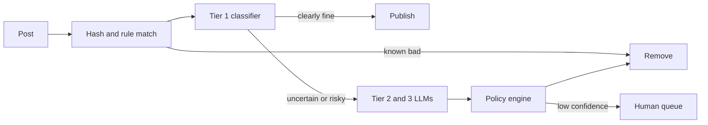

With the cost ceiling in hand, draw the system. A moderation pipeline has two paths with different latency needs: a **synchronous** gate that runs before the post is visible (for severe classes, and cheap enough to run on everything), and an **asynchronous** path that refines decisions in the minutes after publication.



Each box has a job and a failure budget.

| Component | Job | Latency budget |
|---|---|---|
| Hash and rule match | Exact and near-duplicate matches against known bad content, blocklists, rate-based spam rules | < 5 ms |
| Tier 1 classifier | Multi-label scores for every class; cheap, high recall | < 30 ms |
| Tiers 2 and 3 (LLMs) | Read the post with the full policy text; return label, reason code, confidence | 200 ms to 2 s, asynchronous for most |
| Policy engine | Turn scores plus context (account history, reach) into an action | < 10 ms |
| Human queue | Review with priority by severity and reach | Minutes to hours |
| Feedback store | Decisions, reasons, appeals, labels for retraining | Offline |

## One post, step by step

```steps
A post travels through the system
A user submits a post of 80 tokens. The gateway computes a content hash and checks it against a store of known violating hashes. Suppose 15% of the 50M daily posts are exact or near-duplicates; this check costs almost nothing and answers them from cache: $0.15 \times 50\text{M} = 7.5\text{M}$ posts a day never reach a model.
---
The remaining post goes to the Tier 1 classifier, which returns a score per policy class, for example hate 0.03, harassment 0.04, spam 0.02, self-harm 0.01. All are below their allow thresholds, so the post is published immediately. About 92% of posts end here.
---
A different post scores harassment 0.41, between the allow threshold (0.15) and the removal threshold (0.95). It is published provisionally with reduced reach and sent to Tier 2, a small LLM that reads the post with the policy text and returns a label, a one-line reason and its own confidence.
---
Tier 2 returns "harassment, 0.62". That is not decisive, so the post escalates to Tier 3, a large model, which returns "harassment, 0.91, targets a named individual".
---
The policy engine combines 0.91 with context: the author has two prior strikes and the post is reaching 4,000 views an hour. Policy says remove above 0.85 when the account has prior strikes. The post is removed, the author is told which rule applied, and the decision, scores and reason are stored.
---
The author appeals. The case goes to a human reviewer with the post, the scores, the reason and the policy text. The reviewer's verdict is logged as a fresh label and feeds the audit and retraining sets.
```

## The maths of pass-through

Let $f_i$ be the fraction of items that tier $i$ passes to tier $i{+}1$. The number of items reaching tier $k$ per day is

$$
N_k = P \prod_{i=1}^{k-1} f_i
$$

With $P = 50\text{M}$, $f_1 = 0.08$ (Tier 1 escalates 8%), $f_2 = 0.10$ (Tier 2 escalates one tenth of those) and $f_3 = 0.40$ (Tier 3 sends 40% of its cases to a human):

| Tier | Items per day | Share of all posts |
|---|---|---|
| 1 classifier | 50,000,000 | 100% |
| 2 small LLM | 4,000,000 | 8% |
| 3 large LLM | 400,000 | 0.8% |
| Human | 160,000 | 0.32% |

Each tier is applied to a smaller population, so it can be a bigger and slower model. The next topics price these tiers and examine the thresholds.

## Sync versus async

A common probing question: "do you block publication until the model finishes?" The honest answer is by class. For child-safety and credible-threat classes you block, and accept a few hundred milliseconds. For borderline harassment you publish with reduced distribution and decide within minutes, because the harm of a short delay is lower than the harm of freezing every post behind a 2-second LLM. Make the choice explicit per class in the policy table.

## In practice

Idempotency and ordering matter more than they look. Posts get edited; the decision must be tied to a specific version of the content. Retries must not double-strike an account. Store a decision record keyed by `(post_id, content_hash, policy_version)` so you can replay history when the policy changes.

```quiz
{"q": "Tier 1 escalates 8% of 50M posts, Tier 2 escalates 10% of what it receives. How many posts per day reach Tier 3?", "options": ["4,000,000", "400,000", "40,000", "5,000,000"], "answer": 1, "explain": "50M × 0.08 = 4M reach Tier 2; 4M × 0.10 = 400,000 reach Tier 3. 4,000,000 is the count at Tier 2; you must multiply the pass-through fractions along the chain."}
```

```quiz
{"q": "Why publish borderline harassment provisionally with reduced reach instead of blocking until a large LLM decides?", "options": ["Large LLMs are not accurate enough to block", "The delay and cost of a synchronous large-model call on a risky-but-uncertain post outweigh the short-lived harm of limited exposure", "Reduced reach is required by law", "It makes the metrics look better"], "answer": 1, "explain": "The choice is per-class and about expected harm: for borderline classes a brief limited exposure is cheaper than freezing posts. For severe classes the reverse holds and you block. Accuracy is not the reason."}
```
