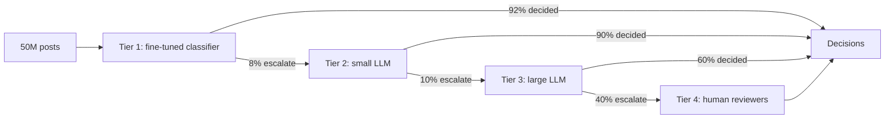
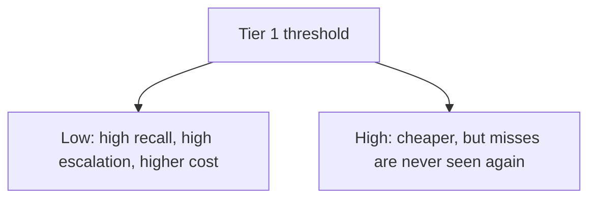

No single model is both cheap enough to read 50 million posts and wise enough to judge sarcasm, quotation and context. So we do what hospitals do with triage: a fast, cheap test for everyone, a better test for the uncertain, a specialist for the hard cases, and a human at the end. This is a **cascade**, and its design question is where to set each hand-off.



## The cost formula

Let $c_i$ be the cost of running tier $i$ on one item, and $f_i$ the fraction of items that tier $i$ passes onward. Every item pays tier 1, a fraction $f_1$ pays tier 2, a fraction $f_1 f_2$ pays tier 3, and so on:

$$
\bar{c} = c_1 + f_1 c_2 + f_1 f_2\, c_3 + f_1 f_2 f_3\, c_h
$$

Here $\bar{c}$ is the expected cost per post and $c_h$ is the cost of one human review.

```steps
Pricing each tier
Tier 1: 4 GPUs at \$2.50 per hour, 730 hours a month: 7,300 dollars a month, or 243.33 a day. Per item: $243.33 / 50\text{M} = 4.87 \times 10^{-6}$ dollars.
---
Tier 2: small LLM with 480 input and 5 output tokens at \$0.10 and \$0.40 per million: $c_2 = 480 \times 10^{-7} + 5 \times 4 \times 10^{-7} = 5.0 \times 10^{-5}$ dollars. It sees 4M items a day: 200 dollars a day.
---
Tier 3: large LLM, 480 input tokens and a 100-token explanation, at \$1.00 and \$4.00: $c_3 = 480 \times 10^{-6} + 100 \times 4 \times 10^{-6} = 8.8 \times 10^{-4}$ dollars. It sees 400,000 items a day: 352 dollars a day.
---
Tier 4: a human at 30 seconds an item and a hypothetical 18 dollars an hour costs $c_h = 18 \times 30/3{,}600 = 0.15$ dollars. At 160,000 items a day: 1,333 reviewer-hours and 24,000 dollars a day (about 167 full-time reviewers).
---
Expected cost per post: $4.87\times10^{-6} + 0.08(5\times10^{-5}) + 0.008(8.8\times10^{-4}) + 0.0032(0.15) = 4.87\times10^{-6} + 4.0\times10^{-6} + 7.04\times10^{-6} + 4.8\times10^{-4} = 4.96 \times 10^{-4}$ dollars.
```

| Tier | Items per day | Cost per day | Share of total |
|---|---|---|---|
| 1 classifier | 50,000,000 | \$243 | 1.0% |
| 2 small LLM | 4,000,000 | \$200 | 0.8% |
| 3 large LLM | 400,000 | \$352 | 1.4% |
| 4 humans | 160,000 | \$24,000 | 96.8% |
| Total | | \$24,795 | 100% |

Two lessons jump out. First, **all the models together cost \$795 a day against \$24,000 for humans**. Second, the cascaded design costs about the same per post (0.0496 cents) as running the large model on everything (0.05 cents), but it also includes human judgement on the hardest 0.32% of posts. Without the cascade you would pay 25,000 dollars a day for model calls and still need the humans.

The leverage is therefore in the pass-through fractions. If a better tier 3 reduces its human escalation $f_3$ from 0.40 to 0.30, human cost falls from 24,000 to 18,000 dollars a day, saving 6,000 dollars a day (180,000 a month), which pays for a lot of extra model spend.

## The recall budget

Every tier can lose a violation: if tier 1 judges it "clearly fine", no later tier ever sees it. If tier $i$ correctly keeps a fraction $r_i$ of the true violations in the pipeline, overall recall before the human stage is approximately

$$
R \approx r_1 \cdot r_2 \cdot r_3
$$

With $r_1 = 0.99$, $r_2 = 0.97$, $r_3 = 0.98$: $R = 0.99 \times 0.97 \times 0.98 = 0.941$. The first tier's threshold is the most consequential in the whole design: it is set for **very high recall** (here 99%) even though that means 8% of posts escalate, because whatever it lets through is final. Later tiers are tuned for precision, because they are protecting the reviewers' time.



## When to add a tier, and when not

Adding a tier is worth it if its marginal saving exceeds its cost. A new mid-size model that sits between tiers 2 and 3 and reduces the share reaching the large model from 0.8% to 0.4% halves tier 3's load from 400,000 to 200,000 items, saving $200{,}000 \times 0.00088 = 176$ dollars a day. If the new model's own cost on the 4M items it must read is 200 dollars a day, the tier loses money. Run this check before adding complexity.

## In practice

Tier thresholds are tuned on a **labelled calibration set**, not by feel, and re-tuned whenever a model changes. Scores from different models are not comparable, so each tier gets its own calibration (for example, isotonic regression mapping score to measured precision). Teams also use cheap signals before any model: account age, link patterns, posting rate. These cost almost nothing and can redirect obvious spam without a model call at all.

```quiz
{"q": "Tier 1 passes 8% to tier 2, tier 2 passes 10% to tier 3, tier 3 passes 40% to humans. A human review costs \\$0.15. What does the human tier add to expected cost per post?", "options": ["\\$0.0032", "\\$0.00048", "\\$0.0012", "\\$0.15"], "answer": 1, "explain": "The fraction reaching a human is 0.08 × 0.10 × 0.40 = 0.0032, times \\$0.15 = \\$0.00048 per post. \\$0.15 is the cost per review, not per post; 0.0032 is the fraction, not the cost."}
```

```quiz
{"q": "Why is tier 1 tuned for much higher recall than later tiers?", "options": ["Because it is the most accurate model", "Because any violation it passes as fine is never seen by a later tier", "Because later tiers cannot detect violations", "Because recall is cheaper to measure there"], "answer": 1, "explain": "A cascade can only narrow the set. Misses at tier 1 are unrecoverable, so it trades precision (more escalations) for recall, and later tiers restore precision."}
```
