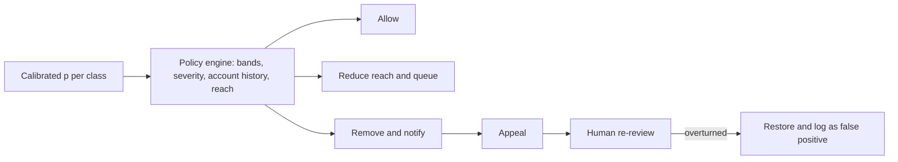

A classifier outputs a number. A platform needs a decision: leave it, limit it, queue it, remove it, suspend the account. The layer in between is the **policy engine**, and it is where moderation systems are either fair or arbitrary. Keep it separate from the models, so that changing a policy does not require retraining anything.

## Several thresholds, not one

Rather than a single block threshold, use bands of the calibrated probability $p$ that the post violates. Each band triggers a different action with a different cost of being wrong.

| Score band (harassment class) | Action | Items per day | Why |
|---|---|---|---|
| $p \ge 0.95$ | Remove automatically, notify author | 200,000 | Precision here is high enough to act without a person |
| $0.60 \le p < 0.95$ | Reduce reach, queue for human | 160,000 | Likely but not certain; a person confirms |
| $0.15 \le p < 0.60$ | Publish with lighter signals (for example a prompt to reconsider) | 1.5M | Low-cost nudge, no penalty |
| $p < 0.15$ | Allow | the rest | |

The 160,000 matches the human tier of the previous topic. Setting band edges is an exercise in decision theory.

## Where the edge goes

Let $a$ be the harm of wrongly removing an innocent post (lost speech, user anger, an appeal to handle) and $b$ the harm of leaving a violating post up. Removing is better than leaving whenever the expected harm of leaving exceeds that of removing:

$$
p \cdot b > (1-p)\cdot a \quad\Longleftrightarrow\quad p > \frac{a}{a+b}
$$

where $p$ is the probability the post truly violates. Take $a = 100$ in arbitrary harm units. For harassment, suppose leaving it up is twice as harmful ($b = 200$): the threshold is $100/300 = 0.33$. For credible threats, $b = 2{,}000$: $100/2{,}100 = 0.048$. For child-safety content, $b = 4{,}900$: $100/5{,}000 = 0.02$. The more severe the class, the lower the score at which you act, and for the severe classes the action at low scores is **escalate to a human**, not auto-remove, because $a$ includes the cost of being publicly wrong about a person.

Two warnings. The $p$ must be a **calibrated probability**, not a raw score, or the formula is meaningless; calibrate each tier on labelled data. And the numbers $a$ and $b$ are policy decisions, not engineering ones, so write them down and have the policy owners sign them.



## Appeals as a measuring instrument

Every removal can be appealed. The **appeal overturn rate** is $o = \text{overturned} / \text{appeals}$. It is tempting to read it as an error rate, but it is only part of the picture: only some wrongly removed users bother to appeal. Let $q$ be the **appeal propensity**, the share of wrongly removed users who appeal. Then

$$
\text{false removals} \approx \frac{\text{overturned appeals}}{q}, \qquad
\text{precision of removals} \approx 1 - \frac{\text{false removals}}{\text{removals}}
$$

```steps
Estimating removal precision from appeals
200,000 posts are auto-removed a day. 5% of authors appeal: 10,000 appeals.
---
Human reviewers overturn 30% of them: $o = 0.30$, so 3,000 posts are restored.
---
Lower bound on false removals is 3,000, which gives precision of at least $1 - 3{,}000/200{,}000 = 98.5\%$. This is optimistic, because it assumes everyone who was wronged appealed.
---
Run a small survey or audit sample of removed posts and find that about 30% of wrongly removed authors appeal, so $q = 0.30$. Then false removals are about $3{,}000 / 0.30 = 10{,}000$.
---
Corrected precision of removals is $1 - 10{,}000/200{,}000 = 95\%$. The true false-removal rate is 5%, more than three times the naive 1.5%.
```

This is why the audit sample in the next topic matters: appeals alone are a biased view. The pattern in the data is useful, though. If overturn rates by class are 5% for spam and 45% for borderline harassment, the harassment band edge is too low or the tier-3 model needs better calibration.

## Reviewer capacity and SLAs

Appeals arrive at a rate $\lambda$ and take a reviewer $s$ seconds. The required staff at utilisation $u$ is

$$
R = \frac{\lambda\, s}{u \cdot 3{,}600 \cdot h}
$$

with $\lambda$ in appeals per day, $h$ working hours per reviewer per day and $u$ the fraction of that time spent reviewing. For $\lambda = 10{,}000$ appeals a day, $s = 60$ s, $u = 0.7$, $h = 8$:

$$
R = \frac{10{,}000 \times 60}{0.7 \times 3{,}600 \times 8} = \frac{600{,}000}{20{,}160} = 29.8
$$

about 30 reviewers. At 100% utilisation you would need 21, but a queue running at full utilisation grows without bound when arrivals fluctuate, so you staff at 70% and keep a surge pool. By Little's law, with a 24-hour SLA and arrivals of 417 an hour, up to $417 \times 24 = 10{,}000$ appeals can legitimately be in the system at any time. Alert on queue age, not queue length.

## In practice

Good systems tell the user which rule was applied (a reason code), allow one-click appeal, and route appeals to a reviewer who did not see the original case. They also feed overturned decisions into the next training set, weighted up because they are exactly the cases the model gets wrong. Rate limits and strike systems avoid making a single bad classification catastrophic: one removal is a warning, three in a week is a suspension.

```quiz
{"q": "40,000 removals a day, 2,000 appeals, 40% overturned. If only 25% of wrongly removed authors appeal, what is the approximate removal precision?", "options": ["98%", "92%", "60%", "99%"], "answer": 1, "explain": "Overturned = 800. False removals ≈ 800 / 0.25 = 3,200. Precision ≈ 1 − 3,200/40,000 = 92%. The 98% figure is the lower bound that assumes everybody wronged appealed."}
```

```quiz
{"q": "Using the rule p > a/(a+b), what happens to the action threshold as the harm b of leaving a violation up grows, with a fixed?", "options": ["It rises, so you act less often", "It falls, so you act at lower probabilities", "It stays the same", "It becomes exactly 0.5"], "answer": 1, "explain": "a/(a+b) shrinks as b grows. For very severe classes you intervene at a few percent probability, usually by escalating to a human rather than removing automatically."}
```
