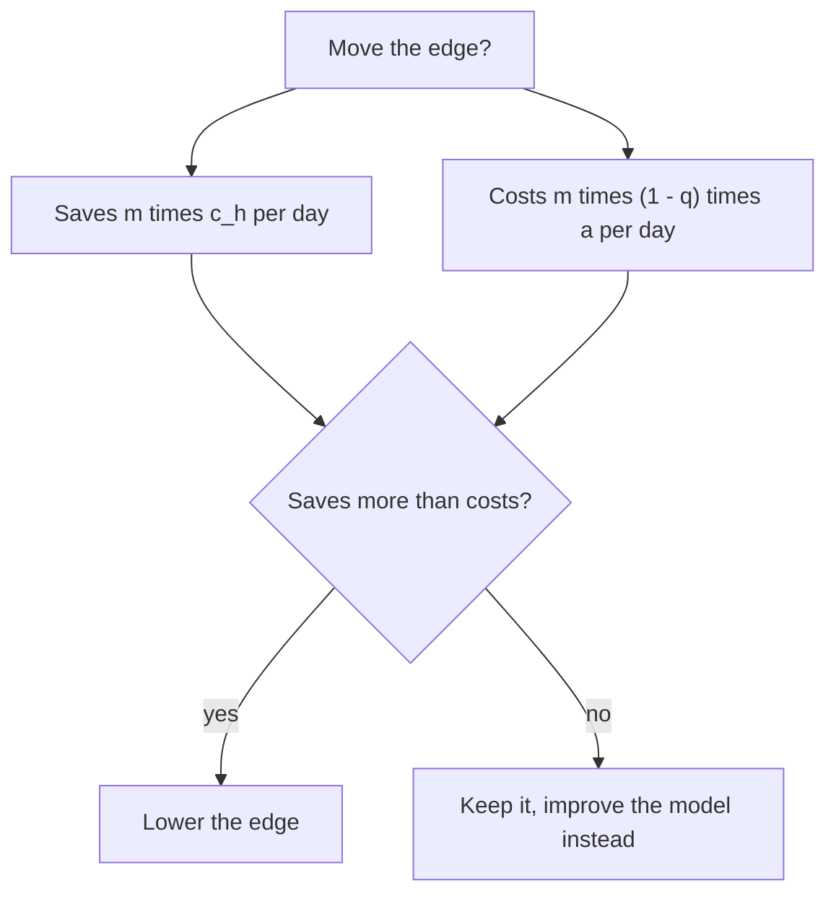

You now have a full design: requirements, a 50M-posts-a-day estimate, a four-tier cascade, calibrated bands, appeals, and an evaluation plan. The last ten minutes of an interview are about **choices**. State each trade-off as two options, the number that separates them, and which way you lean for this product.

## Trade-off tables

| Decision | Option A | Option B | What decides it |
|---|---|---|---|
| Block before publish or after | Synchronous gate: nothing harmful ever visible, adds 30 to 500 ms per post | Asynchronous: instant posting, harm visible for minutes | Severity of the class; child safety and threats go sync, borderline classes async |
| Model for tier 1 | Fine-tuned small classifier: 0.0005 cents per post, needs labelled data | Small LLM zero-shot: 0.005 cents, adapts to new policy by editing a prompt | Policy churn versus volume; many teams use LLM first, then distil into a classifier |
| Auto-remove threshold | High: fewer false removals, larger human queue | Low: smaller queue, more wrongful removals | Cost of a wrong removal versus a human minute (worked below) |
| Human review scope | Review everything flagged: best precision | Review only the uncertain band: cheaper | Reviewer budget and the severity of the class |
| One model for all classes | Simpler to operate | Per-class models and thresholds: each tuned to its base rate | Base rates differ by 100x across classes |

## A worked marginal decision

Should the auto-remove edge move from $p \ge 0.95$ down to $p \ge 0.90$? Suppose $m = 60{,}000$ extra posts a day fall in the new band, and measured precision there is $q = 0.85$. Moving the edge removes them without a human, saving $m\, c_h = 60{,}000 \times 0.15 = 9{,}000$ dollars a day. The price is $m(1-q) = 9{,}000$ extra wrongful removals a day. Let $a_{\$}$ be the cost of one wrongful removal in dollars (appeal handling, churn, trust). Moving the edge pays off if

$$
m\, c_h > m\,(1-q)\, a_{\$} \quad\Longleftrightarrow\quad a_{\$} < \frac{c_h}{1-q} = \frac{0.15}{0.15} = 1.00
$$

So the change is only worth it if a wrongful removal costs the platform under one dollar. Appeal handling alone is about 60 s of reviewer time, or 30 cents, and a user who quits over a wrong removal costs far more. Keep the threshold at 0.95. The calculation is the point, not the verdict: it turns a policy argument into a number the policy owners can dispute.



## What the interviewer probes

```steps
Likely follow-up questions, and the shape of a good answer
**"Why not use the biggest model on everything?"** Cost: 750,000 dollars a month for text alone, against 7,300 for a classifier, and it still leaves the human queue. Use tiers; spend big-model tokens on the 0.8% that need them.
---
**"Your classifier is 95% recall and 2% false positives. Is that good?"** Not enough information: compute precision at the base rate. At 0.5% it is 19%, which means 80% of the review queue is innocent posts. Ask for the per-class base rates.
---
**"How do you know recall?"** Stratified audit of unflagged items by score, rule of three for the empty strata, and a refreshed red-team set. Appeals only cover precision and are biased by who appeals.
---
**"A new slur starts trending. What happens?"** Rules and blocklists patch within minutes; rapid labelling of examples; fine-tune within days; the tier-2 prompt can be edited the same hour. Monitor flag volume and per-week recall.
---
**"How do you handle languages other than English?"** Per-language calibration sets and thresholds, native reviewers, a report of recall by language, and a rule that a language with too little data gets conservative automation and more human review.
---
**"What if the model is attacked?"** Treat post text as untrusted data in prompts, use structured output, run a separate injection classifier, and keep policy decisions in code, not in the model's text.
```

Interviewers also listen for what is missing. Strong candidates mention reviewer wellbeing, appeals and transparency, legal retention requirements, the difference between removing and demoting, and that the cost of being wrong is asymmetric by class. Weak candidates give one model, one threshold and one accuracy number.

## One-minute summary to close with

Violations are rare, so precision is driven by false-positive rate and base rate. A four-tier cascade (hash and rules, classifier, small LLM, large LLM, human) keeps model cost near 800 dollars a day while humans, at about 24,000, dominate the bill, so every design choice aims at fewer human minutes per correct decision. Bands per class come from the cost of each error. Appeals plus stratified audits measure precision and recall honestly, and drift monitoring keeps both from decaying.

Try the thresholds yourself in a small guarded assistant: block too aggressively and legitimate users are refused, too gently and attacks pass.

```sandbox
guarded-assistant
```

```quiz
{"q": "Lowering the auto-remove threshold moves 20,000 posts a day from human review (0.15 dollars each) to automatic removal, and precision in that band is 90%. What is the break-even cost of one wrongful removal?", "options": ["0.15 dollars", "1.50 dollars", "0.015 dollars", "3.00 dollars"], "answer": 1, "explain": "Savings 20,000 × 0.15 = 3,000 dollars. Wrongful removals 20,000 × 0.10 = 2,000. Break-even cost = 3,000 / 2,000 = 1.50 dollars, i.e. c_h/(1−q) = 0.15/0.10. If a wrongful removal costs more than that, keep the humans."}
```

```quiz
{"q": "Which statement about asynchronous (publish-then-review) moderation is most defensible?", "options": ["It is always better because it is faster", "It suits borderline classes where brief exposure is a smaller harm than delaying every post, but not severe classes", "It removes the need for appeals", "It makes calibration unnecessary"], "answer": 1, "explain": "The decision is per class and depends on expected harm of exposure versus delay. Severe classes are blocked synchronously; async never removes the need for appeals or calibration."}
```
