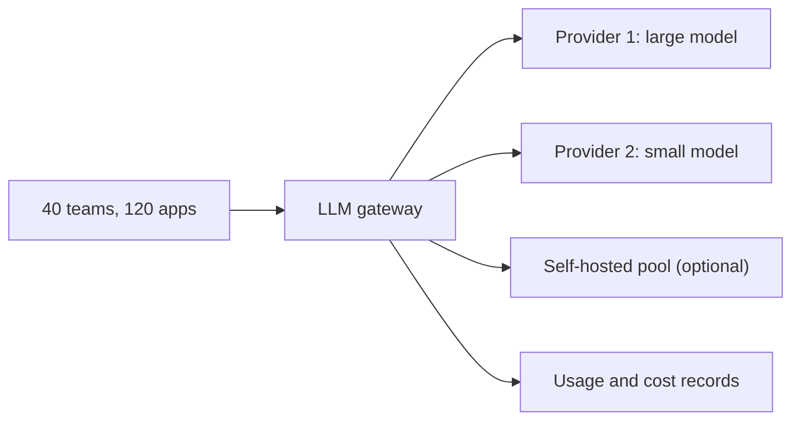

```callout-before
Before you start
This case follows the eight steps from [A Framework for LLM System Design](/learn/llm-system-design/design-framework). You should be comfortable turning daily volumes into QPS and token costs, and with Little's law ($\text{concurrency} = \text{arrival rate} \times \text{duration}$).
```

Picture a company eighteen months into its LLM adoption. The support team calls one provider, the search team calls another, three teams run their own small models on borrowed GPUs, and finance receives four invoices nobody can split by product. API keys are pasted into config files. When one provider had an outage last month, six features broke at once and nobody knew which ones until customers complained.

The interview prompt is: **design an internal LLM platform** that every team uses instead of calling models directly. The heart of it is an **LLM gateway**: one service that every model call passes through, which authenticates the caller, applies policy, routes to a model, enforces quotas, caches, records what happened and attributes the cost to the team that caused it.

This is a different kind of case from the others in the module. The "users" are internal teams (**tenants**), the product is reliability and accountability, and the main risk is that a shared layer becomes a shared point of failure.

## Clarify the requirements

Ask before designing. A good set of questions and plausible answers:

| Question | Answer we assume |
|---|---|
| Who calls the platform? | About 120 internal applications owned by 40 teams; batch jobs and interactive products |
| Which models? | Two hosted providers (one large, one small model tier) plus an option to self-host |
| Must it stream? | Yes: chat products need token streaming |
| Latency the platform may add? | p99 overhead under 30 ms on top of the model |
| Availability target? | 99.95% for the gateway itself |
| Data rules? | Prompts may contain customer data; logs must be access-controlled and PII-redacted; tenants must never see each other's data |
| Cost goals? | A per-team monthly bill; reduce total spend without lowering quality |

**Functional requirements**: one API for all models; credentials held centrally; routing and fallback; per-tenant quotas; caching; request logging; per-tenant cost reports. **Non-functional**: low added latency, high availability, isolation between tenants, and the ability to add a provider without every team changing code.

## Back-of-the-envelope estimation

Assume the 120 applications together send $R = 20$ million requests per day, averaging $t_{in} = 2{,}000$ input tokens and $t_{out} = 400$ output tokens. With 86,400 seconds in a day and a peak factor $k = 3$:

$$
\bar{\lambda} = \frac{R}{86{,}400} = \frac{2 \times 10^7}{86{,}400} \approx 231.5 \text{ req/s}, \qquad \lambda_{peak} = k\,\bar{\lambda} \approx 694 \text{ req/s}
$$

Here $\bar{\lambda}$ is the average arrival rate and $\lambda_{peak}$ the rate the platform must survive. Daily tokens are $R \cdot t_{in} = 40$ billion input and $R \cdot t_{out} = 8$ billion output.

Cost uses the module's hypothetical prices: large model $p_{in} = \$1.00$ and $p_{out} = \$4.00$ per million tokens; small model $\$0.10$ and $\$0.40$.

$$
C_{day} = \frac{R\,t_{in}}{10^6}\,p_{in} + \frac{R\,t_{out}}{10^6}\,p_{out}
$$

If every request went to the large model: $40{,}000 \times \$1 + 8{,}000 \times \$4 = \$72{,}000$ per day, or **\$2.16 million per month** (30 days). If the platform can route 70% of traffic to the small model without losing quality (the subject of topic 3), the bill becomes $\$5{,}040 + \$21{,}600 = \$26{,}640$ per day, **\$799,200 per month**: a 63% reduction. That single number is why companies build this layer.

**Concurrent streams.** A streaming request holds a connection open for its whole duration. With a time to first token of 0.4 s and 400 output tokens at 15 ms each, a request lasts $T = 0.4 + 400 \times 0.015 = 6.4$ s. By Little's law:

$$
N = \lambda_{peak} \cdot T = 694.4 \times 6.4 \approx 4{,}444 \text{ open streams}
$$

If one gateway instance comfortably holds 1,000 concurrent streams (a hypothetical benchmark for an async proxy), you need 5 instances at peak, and you deploy at least 3 per availability zone across 3 zones so that losing a zone still leaves capacity.

**Logs.** A metadata record (tenant, model, token counts, latency, cost, status) is about 1 KB. A full payload adds roughly 2,400 tokens at about 4 bytes each, 9.6 KB. Storing everything: $2 \times 10^7 \times 10.6\text{ KB} = 212$ GB per day, 6.36 TB for 30 days. Metadata for all requests plus payloads for a 10% sample: about 1.18 TB per 30 days.

| Quantity | Formula | Value |
|---|---|---|
| Average QPS | $R / 86{,}400$ | 231.5 req/s |
| Peak QPS | $3 \bar{\lambda}$ | 694 req/s |
| Input tokens per day | $R\,t_{in}$ | 40 B |
| Output tokens per day | $R\,t_{out}$ | 8 B |
| Monthly cost, all large | $30\,C_{day}$ | \$2.16 M (hypothetical prices) |
| Monthly cost, 70/30 routing | | \$799,200 |
| Open streams at peak | $\lambda_{peak} T$ | ≈ 4,444 |
| Gateway instances | $N / 1{,}000$, then zone redundancy | 5 needed, 9 deployed |
| Logs, 30 days, full payloads | | 6.36 TB |

## Should the platform self-host the small model?

Take the small-model share of output: $0.7 \times 8\text{ B} / 86{,}400 \approx 64{,}815$ tokens/s on average, 194,444 at peak. If one GPU sustains 1,500 output tokens/s at the latency target and you plan for 70% utilisation:

$$
G = \frac{194{,}444}{1{,}500 \times 0.7} \approx 185.2 \Rightarrow 186 \text{ GPUs}, \qquad 186 \times \$2.50 \times 730 = \$339{,}450 \text{ per month}
$$

The hosted small model costs $\$5{,}040 \times 30 = \$151{,}200$ per month at our hypothetical price. Self-hosting loses here, because you pay for peak capacity all day while the API bills only for tokens used. The answer flips when prices are higher, traffic is flatter, or data rules forbid sending prompts out. Saying this out loud is exactly the kind of reasoning an interviewer wants.



## In practice

The numbers that matter most for a platform are not the model's: they are the overhead budget (tens of milliseconds), the availability of the gateway (it multiplies into every product's availability), and the spend reduction from routing and caching. Teams adopt a platform when it is the easiest path, so a clean SDK and good defaults matter as much as the architecture. A common mistake is estimating only average QPS: quotas, instance counts and provider rate limits all have to be set against the peak.

```quiz
{"q": "The platform serves 20 M requests/day with a peak factor of 3, and each streaming request lasts 6.4 s. Roughly how many concurrent streams must the gateway hold at peak?", "options": ["About 1,480", "About 4,440", "About 231", "About 128,000"], "answer": 1, "explain": "Peak rate is $3 \\times 2\\times10^7/86{,}400 \\approx 694$ req/s; Little's law gives $694 \\times 6.4 \\approx 4{,}444$ open streams. 1,480 uses the average rate instead of the peak; 231 is just the average QPS, ignoring that each request stays open for seconds."}
```

```quiz
{"q": "At the hypothetical prices, why does self-hosting the small-model traffic cost more than the API in this design?", "options": ["GPUs are slower than API providers", "You provision GPUs for the peak and pay for them all day, while the API bills only tokens actually used", "Self-hosted models need more output tokens per answer", "The KV cache does not fit"], "answer": 1, "explain": "186 GPUs sized for a 3x peak cost \\$339,450/month even when traffic is at average; the API charges \\$151,200 for the same tokens. Throughput per GPU is an assumption, not the issue: the gap comes from paying for idle peak capacity."}
```
