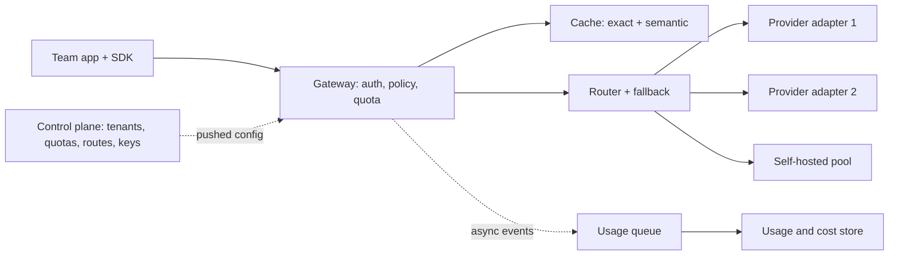

Think of the gateway as the airport security and departures board for model calls. Every passenger (request) goes through the same checkpoint, which checks who they are, whether they are allowed to fly, which gate (model) they go to, and logs that they passed. The checkpoint must be fast, because everyone queues behind it, and it must never close, because nobody can fly without it.

Concretely, the platform splits into two halves. The **data plane** is the hot path every request travels: authentication, policy, quota, cache, routing, the provider call and streaming back. The **control plane** is everything that configures the data plane but is not on the request path: the tenant registry, quota and routing configuration, the prompt registry, the provider key vault, and the usage and billing pipeline. Keeping these apart is the most important structural decision: if the billing database is slow, requests must not be.

## High-level architecture



Three details are worth naming in an interview:

- **Provider adapters** translate one internal request schema into each provider's API and back, including streaming formats, error codes and token-usage fields. Teams code against one interface; adding a provider is an adapter, not a migration.
- **Configuration is pushed, not fetched.** Each gateway instance holds tenant, quota and routing rules in memory and receives updates from the control plane. If the control plane is down, the gateway keeps serving with the last good config.
- **Usage events are asynchronous.** The gateway emits one event per request to a queue and returns. Billing, dashboards and audits consume the queue. A slow consumer never adds latency.

## One request, end to end

```steps
A support chatbot asks for an answer
The app calls the SDK with `tenant=support-bot`, `route=chat-default`, a prompt of 2,000 tokens and `max_tokens=400`. The SDK adds a request id and sends it over a pooled HTTPS connection to the nearest gateway instance.
---
Authenticate and apply policy (about 1 ms)
The gateway validates the tenant's credential against its in-memory key table, checks the route is allowed for this tenant, and runs the PII redaction rules configured for the tenant on the prompt.
---
Reserve quota (about 2 ms)
It estimates the cost of the request as input tokens plus `max_tokens` = 2,400 tokens and atomically debits the tenant's token bucket in a shared in-memory store. If the bucket is empty it returns HTTP 429 with a retry-after hint instead of calling any model.
---
Check the cache (3 ms exact; about 20 ms semantic)
It hashes the tenant id, route, prompt version, model parameters and messages into an exact-match key. On a miss, and only if the tenant has opted in, it embeds the last user message and searches that tenant's semantic cache. Both miss.
---
Route and call (model time dominates)
The router picks the small model for this route, sends the request through adapter 2 and streams tokens back to the app as they arrive. Had the provider timed out before the first token, the router would have retried once on the fallback model.
---
Settle and record (off the hot path)
When the stream ends, the gateway refunds the unused part of the reservation (it reserved 400 output tokens, 180 were used), writes the response to the cache, and emits a usage event with tokens, latency, model, cost and status to the queue.
```

## The overhead budget

Every millisecond the gateway adds is paid by every product. Let $o_i$ be the time of each in-path step. The total added latency is the sum along the path:

$$
O = \sum_i o_i = o_{auth} + o_{quota} + o_{exact} + o_{embed} + o_{vector} + o_{route}
$$

With the numbers from the walkthrough, $O = 1 + 2 + 3 + 15 + 5 + 1 = 27$ ms on a semantic-cache miss. Against a model time to first token of 400 ms that is $27 / 400 = 6.75\%$ of TTFT. Without the semantic cache, $O = 7$ ms. So the expensive line item is the semantic lookup, which is why it is opt-in per route and why it can run in parallel with a speculative model call for latency-critical routes.

Percentiles do not simply add, but sums of means are a fine first estimate. For the p99 budget you measure the gateway's own latency histogram (time from request received to first byte sent upstream) separately from model latency, so a provider slowdown is never blamed on the gateway or vice versa.

| Step | Typical time | How to keep it small |
|---|---|---|
| Auth + policy | ~1 ms | In-memory key table, pushed config |
| Quota reservation | ~2 ms | In-memory store in the same zone; fail-open rules |
| Exact cache | ~3 ms | Hash lookup, small values |
| Semantic cache | ~20 ms | Opt-in, embed only the last user turn, per-tenant index |
| Routing | ~1 ms | Rules evaluated in process |
| Usage logging | 0 ms in path | Async queue |

## What fails open, what fails closed

Each dependency needs a decided behaviour when it is down. If the quota store is unreachable, the gateway can **fail open** (serve, using a local per-instance approximation of the quota) or **fail closed** (reject). For an internal platform, failing open with a local cap is usually right: a quota outage should not become a company-wide product outage. Authentication, by contrast, fails closed: an unauthenticated call must never reach a provider with company credentials. The cache always fails open: a miss is just a slower request.

## In practice

The SDK matters as much as the server. It should set timeouts, propagate a request id, retry only on retryable errors with jittered backoff, and expose streaming identically for every model. Platforms that skip the SDK find each team writing its own retry loop, and a provider blip turns into a retry storm. A frequent design mistake is putting synchronous database writes for billing on the request path; at 694 req/s peak a database hiccup then adds seconds to every product.

```quiz
{"q": "On a semantic-cache miss the gateway adds 27 ms; without the semantic cache it adds 7 ms. The model's TTFT is 400 ms. What fraction of TTFT does the semantic cache lookup alone add?", "options": ["6.75%", "5%", "1.75%", "27%"], "answer": 1, "explain": "The semantic part is $27 - 7 = 20$ ms (embedding 15 + vector search 5), and $20/400 = 5\\%$. 6.75% is the whole gateway overhead, not just the semantic lookup; 1.75% is the overhead without it."}
```

```quiz
{"q": "The control plane database goes down for ten minutes. In a well-designed gateway, what happens to requests?", "options": ["All requests fail until it recovers", "Requests keep being served with the last pushed configuration; only config changes are delayed", "Requests are served but without authentication", "Requests are queued until the database returns"], "answer": 1, "explain": "The data plane holds config in memory and does not depend on the control plane per request, so serving continues with the last good config. Dropping authentication would be failing open on the one check that must fail closed."}
```
