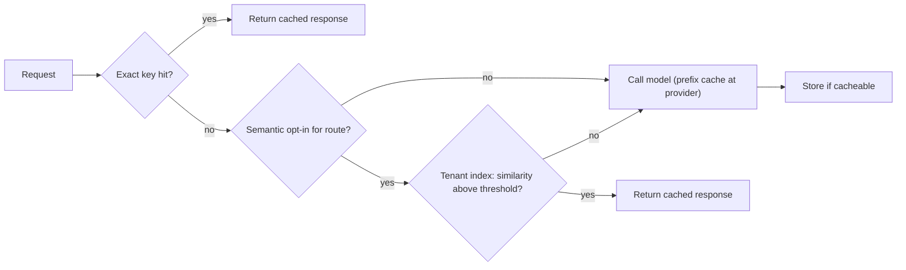

A library photocopier with a "recent copies" tray saves time when many people copy the same page. It becomes a scandal the day someone picks up a colleague's medical form from the tray. Caching on a shared LLM platform has both halves of that story: real savings, and a real risk of handing one tenant's data to another.

Three caches can sit in or behind the gateway. An **exact-match cache** returns a stored response when the full request (messages, model, parameters) is byte-for-byte identical to an earlier one. A **semantic cache** embeds the query and returns a stored response when a previous query is close enough in embedding space. **Prefix (prompt) caching** happens at the provider or serving engine: a long shared prefix such as a system prompt is processed once and its KV cache reused, so you pay a discounted rate for those input tokens. The mechanics are covered in [Caching Repeated Work](/learn/inference-and-serving/caching); here we decide what a platform should do.

## What each cache saves

Let $h$ be a cache's hit rate, $\bar{c}$ the mean model cost per request, $R$ requests per day and $c_{look}$ the cost of a lookup (for a semantic cache, mainly the embedding). Daily savings are

$$
S = h\,R\,\bar{c} - R_{look}\,c_{look}
$$

where $R_{look}$ is the number of requests that perform a lookup.

**Worked example.** After routing, the platform's mean cost is $\bar{c} = \$26{,}640 / 2\times10^7 = \$0.001332$. Measured on a week of traffic, the exact cache hits 8% (evaluation suites, retried batch jobs and identical classification inputs repeat a lot) and the semantic cache hits a further 5% on opted-in FAQ-style routes, so 13% of requests skip the model:

$$
0.13 \times \$26{,}640 = \$3{,}463.20 \text{ per day}
$$

The semantic lookup runs on the 92% that miss the exact cache. Embedding only the last user message (about 100 tokens) at the hypothetical \$0.02 per million tokens costs $1.84\times10^7 \times 100 \times 0.02/10^6 = \$36.80$ per day. Embedding the whole 2,000-token prompt would cost \$736 per day and match worse, because two requests with the same question but different retrieved context look different. Net saving: \$3,426.40 per day, about **\$102,800 per month**.

**Prefix caching** is often bigger and riskless. Suppose 1,200 of the 2,000 input tokens are a fixed system prompt and tool definitions, and 60% of requests reuse a warm prefix. Then $0.6 \times 1{,}200 / 2{,}000 = 36\%$ of input tokens are cached. Daily input spend after routing is \$14,800; at a hypothetical 90% discount on cached tokens the saving is $0.36 \times 0.9 \times \$14{,}800 = \$4{,}795.20$ per day, about \$143,900 per month. The platform's role here is enforcing prompt layout: stable content first, variable content last, so prefixes actually match.

| Cache | Typical hit rate | Correctness risk | Where it lives |
|---|---|---|---|
| Prefix cache | High on templated routes | None: same tokens, same computation | Provider or serving engine |
| Exact-match | Low to moderate | Low, if keyed correctly | Gateway, key-value store |
| Semantic | Route-dependent | Wrong answer for a similar but different question | Gateway, per-tenant vector index |

## The cache key is a security boundary

An exact-match key must include everything that could change the answer or who may see it:

$$
k = H(\text{tenant} \,\|\, \text{route} \,\|\, \text{model version} \,\|\, \text{prompt version} \,\|\, \text{params} \,\|\, \text{messages})
$$

where $H$ is a cryptographic hash and $\|$ is concatenation. Leave out the tenant and two teams sending the same prompt share a response; harmless for a public FAQ, a breach if the "prompt" contained a customer's account details and the response repeated them. Leave out the model or prompt version and an upgrade keeps serving stale answers. Leave out the parameters and a `temperature=0` answer is returned to a caller who wanted varied samples.

For semantic caches, add one more rule: **one index per tenant** (or a mandatory tenant filter on every search), and never cache responses whose content depends on the user, such as anything generated with personal data or tool results. In practice this means semantic caching is opt-in per route and off by default.

## Wrong hits and staleness

A semantic cache trades misses for occasional wrong answers. If 5% of 20 million daily requests are semantic hits and 2% of those are wrong (a similar question with a different correct answer: "cancel my order" versus "cancel my subscription"), that is $0.05 \times 2\times10^7 \times 0.02 = 20{,}000$ wrong answers per day. Raising the similarity threshold lowers the wrong-hit rate and the hit rate together, so the threshold is tuned per route on labelled pairs.

Staleness is the other failure. Every entry gets a time-to-live, and the cache is flushed for a route when its prompt version, model or underlying knowledge base changes. A refund policy updated on Monday must not be quoted from Friday's cache.



## In practice

Report cache savings per tenant, and decide how to bill hits: charging a hit at zero gives the savings to whoever happened to ask second, while charging a small flat fee funds the cache infrastructure. Start with prefix caching and exact caching everywhere, add semantic caching only to routes with repetitive, non-personal questions, and log every semantic hit with its similarity score so wrong hits can be audited.

```quiz
{"q": "Two tenants send the identical prompt to the same route. The exact-match cache key is H(route, model version, prompt version, params, messages). What is the problem?", "options": ["None: identical prompts deserve identical answers", "The key omits the tenant, so one tenant can receive a response produced for the other, which can leak data", "The key omits the timestamp, so it never expires", "Hashes cannot be used as cache keys"], "answer": 1, "explain": "Without the tenant in the key, responses cross the tenant boundary. Identical text can still carry tenant-specific data. Expiry is handled by a TTL, not by putting time in the key (which would make every key unique)."}
```

```quiz
{"q": "Mean cost per request is \\$0.001332 over 20 M requests/day. A semantic cache adds 5% hits, and its embedding lookups cost \\$37/day. What is its approximate daily net saving?", "options": ["\\$1,295", "\\$1,332", "\\$3,426", "\\$26,603"], "answer": 0, "explain": "Gross saving $0.05 \\times 2\\times10^7 \\times 0.001332 = \\$1{,}332$; minus \\$37 of embeddings gives about \\$1,295. \\$3,426 is the combined exact-plus-semantic figure at a 13% hit rate."}
```
