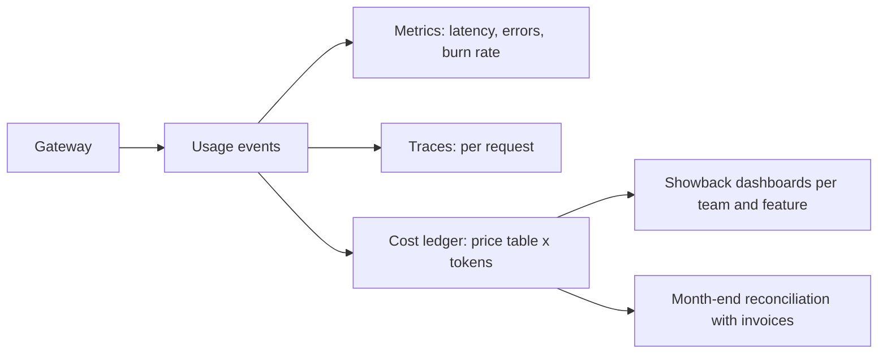

A shared electricity meter for a whole apartment building tells you the building used too much power. It cannot tell you that flat 4B left the heater on all winter. Until each flat has its own meter, nobody changes behaviour, and the argument about splitting the bill never ends.

An LLM platform is the place where every model call can be metered once, consistently, for the whole company. Two jobs share the same data. **Observability** answers "is the platform healthy, and if not, where is it failing?" **Cost attribution** answers "who spent what, on which feature?" Both depend on the same thing: a rich, structured **usage event** emitted for every request.

## The usage event

Each request produces one record with identifiers, measurements and outcome:

| Group | Fields |
|---|---|
| Who | tenant, application, route, feature tag, environment (prod/staging), hashed end-user id |
| What | provider, model and version, prompt version, cache status (exact/semantic/miss), fallback used |
| How much | input tokens, cached input tokens, output tokens, computed cost |
| How fast | gateway overhead, queue wait, time to first token, total duration |
| Outcome | status code, error class, safety-filter actions, trace id |

The **feature tag** is the field teams forget and finance needs most: "support-bot" is one tenant, but "draft reply", "summarise thread" and "classify intent" are three features with very different value. The SDK should require it.

Cost is computed at the gateway from token counts and a versioned price table, not taken from provider invoices, so it is available within seconds and can be reconciled with the invoice at month end:

$$
c = \frac{t_{in} - t_{cached}}{10^6}\,p_{in} + \frac{t_{cached}}{10^6}\,p_{cached} + \frac{t_{out}}{10^6}\,p_{out}
$$

where $t_{cached}$ is the number of input tokens served from a prefix cache at price $p_{cached}$. For a large-model request with 2,000 input tokens of which 1,200 are cached, 400 output tokens, and hypothetical prices \$1.00, \$0.10 and \$4.00 per million: $800 \times 10^{-6} + 1{,}200 \times 0.1 \times 10^{-6} + 400 \times 4 \times 10^{-6} = \$0.00080 + \$0.00012 + \$0.0016 = \$0.00252$, against \$0.0036 uncached.

## Health: SLOs and burn rates

The gateway's own **service level objective** (SLO) is 99.95% of requests succeeding without a platform-caused error. That leaves an **error budget** of $1 - 0.9995 = 0.05\%$ of requests per month. The **burn rate** says how fast the budget is being spent:

$$
b = \frac{\text{observed error rate}}{1 - \text{SLO}}
$$

If errors run at 0.7% for an hour, $b = 0.007 / 0.0005 = 14$: at that pace the whole 30-day budget is gone in $30 / 14 \approx 2.1$ days. A common alerting rule pages when the one-hour burn rate exceeds 14.4, because one hour at that rate consumes $14.4 / 720 = 2\%$ of a 720-hour month's budget. Slower burns raise a ticket instead of a page.

Separate the platform's errors from the providers'. A provider returning 503s is a dependency failure the platform should absorb with fallbacks; a gateway bug is the platform's own. Dashboards per provider, per route and per tenant make the difference visible in minutes. Deeper incident practice is in [Observability and Incident Analysis](/learn/production-systems/observability).

## Attribution: showback and chargeback

**Direct costs** (model tokens) attribute exactly from usage events. **Shared costs** do not: gateway servers, the cache cluster, vector indexes, the platform team's salaries, reserved GPU commitments. Two reporting styles exist. **Showback** reports each team's costs without moving money; **chargeback** actually bills team budgets. Showback first, chargeback once the numbers are trusted.

Shared costs are allocated with an **allocation key** $u_i$, a usage measure for tenant $i$:

$$
a_i = \frac{u_i}{\sum_j u_j}\,C_{shared}
$$

The choice of key decides the bill, so choose it by what drives the cost.

```steps
Allocating 30,000 dollars of shared cost
Three tenants in a month. Direct model spend: A \$120,000, B \$60,000, C \$20,000 (total \$200,000). Requests: A 2 M, B 6 M, C 12 M (C sends many cheap classification calls). Shared cost: \$12,000 of gateway and cache infrastructure plus \$18,000 of platform team time.
---
Allocate everything by spend: A gets $\tfrac{120}{200} \times 30{,}000 = \$18{,}000$, B \$9,000, C \$3,000. But C sends 60% of all requests, which is what drives gateway servers.
---
Allocate everything by requests: A gets $\tfrac{2}{20} \times 30{,}000 = \$3{,}000$, B \$9,000, C \$18,000. Now C pays most of the platform team's time, though its spend is the smallest.
---
Allocate by driver: infrastructure by requests (A \$1,200, B \$3,600, C \$7,200) and team time by spend (A \$10,800, B \$5,400, C \$1,800). Totals: A \$12,000, B \$9,000, C \$9,000. Each team pays for what it actually causes, and the method is easy to explain.
```

**Reserved capacity** needs its own rule. If the company commits to self-hosted GPUs and tenants reserve slices, charge each tenant for its reservation whether used or not; otherwise nobody gives back capacity they no longer need. Unreserved idle capacity is a platform cost, shared by the driver rule above.



## In practice

Log payloads (prompts and responses) separately from metadata, with tighter access control, PII redaction and shorter retention: metadata answers almost every cost and health question. Add per-tenant budget alerts at 50%, 80% and 100% of the month's budget, because the most common cost incident is an agent or batch loop that runs all weekend. Reconcile the ledger with provider invoices monthly; a drift of more than a few percent usually means a price table out of date or a token-counting bug in an adapter.

```quiz
{"q": "The gateway SLO is 99.9%. Errors run at 0.5% for one hour. What is the burn rate?", "options": ["0.5", "5", "50", "2"], "answer": 1, "explain": "The error budget is $1 - 0.999 = 0.001$, so $b = 0.005/0.001 = 5$. At that rate the 30-day budget lasts 6 days. Answering 50 uses the 99.99% budget of 0.0001 by mistake."}
```

```quiz
{"q": "Tenant C has 10% of the model spend but sends 60% of requests. Shared gateway infrastructure scales with request count. If you allocate that infrastructure cost by spend, what happens?", "options": ["Costs are allocated fairly because spend reflects value", "C is under-charged for the servers it drives and the other tenants subsidise it", "C is over-charged", "Nothing, because allocation keys do not affect totals"], "answer": 1, "explain": "Allocating by spend gives C only 10% of a cost it drives 60% of, so A and B subsidise C. Totals are unchanged by the key, but each team's bill, and therefore its incentives, changes a lot."}
```
